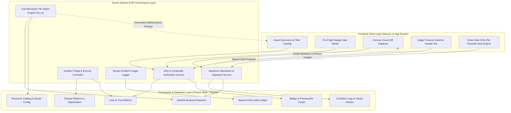
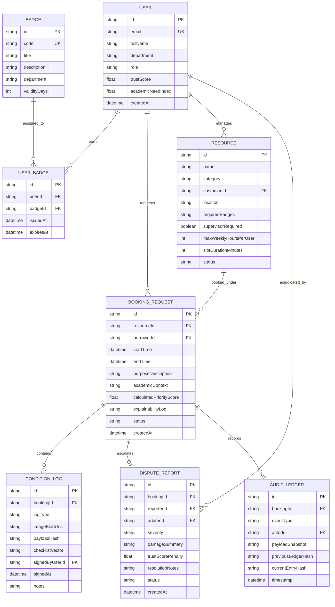
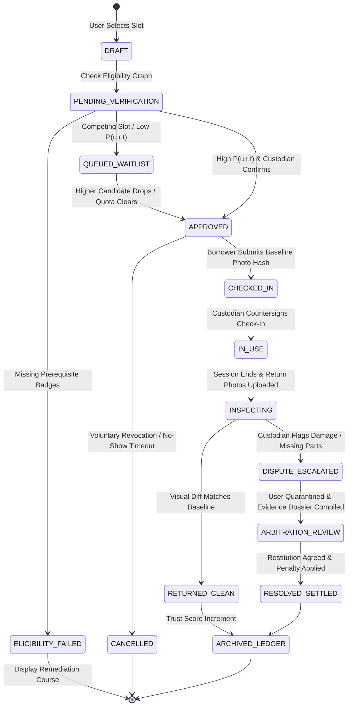

# OpenLab Protocol: Trust-Governed Institutional Resource Sharing Engine
## Technical Solution Architecture & Systems Engineering Specification

**Document Version:** 1.0.0-PROD  
**Classification:** Hackathon Technical Architecture & System Whitepaper  
**Target Environment:** 100% Pure-Software Application (Zero IoT/Hardware Dependencies)  
**Target Domain:** Higher Education Institutions, Shared University Research Labs, and Student MakerSpaces  

---

## 1. Executive Summary & Core Architectural Thesis

### 1.1 The Institutional Sharing Dilemma
Higher education and research institutions harbor millions of dollars in advanced capital assets—multi-GPU machine learning clusters, 5-axis CNC routers, multi-GHz oscilloscopes, cleanroom bays, and industrial 3D printers. Historically, over **60% to 75%** of this physical capacity sits dormant outside semester-end thesis crunches. 

The underlying bottleneck is **not physical locking**, but rather an administrative and incentive vacuum:
* **Lab Custodians** face asymmetric risk (zero upside for sharing, 100% liability for unassigned damage and safety non-compliance).
* **Students and Innovators** confront opaque departmental silos, ghost bookings (no-shows holding peak slots), and gatekeeping favoritism.
* **Academic Deans and Auditors** operate blind, lacking empirical utilization logs while funding duplicative CapEx across adjacent faculties.

### 1.2 The Core Architectural Thesis: From Passive Calendars to Stateful Protocol Governance
Current institutions rely on "Passive Calendar Scheduling" (Google Forms, Calendly, Microsoft Bookings, Excel). These systems treat reservations as lightweight, unconstrained strings on a calendar grid—completely detached from user competencies, asset condition lifecycle, or fairness economics.

**OpenLab Protocol** replaces passive booking with **Stateful Protocol Governance**:
* Every reservation is executed as a **verifiable digital contract**.
* Entry requires **deterministic qualification gating** evaluated against a machine-readable prerequisite competency graph.
* Allocation conflicts are resolved via a **mathematical fair-share engine** that penalizes hoarding and starvation.
* Accountability is enforced via a **cryptographic, dual-signature condition attestation protocol** that captures physical asset state at check-in and return without requiring IoT hardware.

```
+-----------------------------------------------------------------------------------------------------+
|                               PARADIGM SHIFT: ARCHITECTURAL COMPARISON                              |
+-----------------------------------------------------------------------------------------------------+
|                                                                                                     |
|  LEGACY: PASSIVE CALENDAR SCHEDULING               OPENLAB PROTOCOL: STATEFUL GOVERNANCE            |
|  -----------------------------------               -------------------------------------            |
|  * Unchecked applicant credentials                 * Cryptographic Pre-Flight Eligibility Gating   |
|  * First-Come, First-Served hoarding               * Algorithmic Fair-Share Queue (Decay & Quotas)  |
|  * Ghost reservations (38% no-show rate)          * Automated Slashing & Standby Reclamation       |
|  * "Honor-system" handovers; blame loops           * Multi-Party Visual Proof-of-Condition Hash     |
|  * Mutable spreadsheets / ephemeral emails         * Append-Only Tamper-Evident Event Ledger        |
|                                                                                                     |
+-----------------------------------------------------------------------------------------------------+
```

---

## 2. The Three Architectural Pillars

```
                                  +------------------------------------+
                                  |         OPENLAB PROTOCOL           |
                                  |    Core Architectural Pillars      |
                                  +-----------------+------------------+
                                                    |
         +------------------------------------------+------------------------------------------+
         |                                          |                                          |
+--------+-------------------------+       +--------+-------------------------+       +--------+-------------------------+
|        PILLAR A:                 |       |        PILLAR B:                 |       |        PILLAR C:                 |
|  Proof-of-Condition Dual-        |       |  Anti-Monopoly Fair-Share        |       |  Deterministic Competency &      |
|  Signature Handover Protocol     |       |  Dynamic Allocation Engine       |       |  Pre-Flight Eligibility Graph    |
|                                  |       |                                  |       |                                  |
|  * Client-side payload hashing   |       |  * Mathematical priority P(u,r,t)|       |  * Dynamic prerequisite graphs   |
|  * Visual diff delta inspector   |       |  * Diminishing marginal access   |       |  * Zero-trust API validation     |
|  * Non-repudiation condition log |       |  * Transparent explainable queue |       |  * Automated supervisor escalation|
+----------------------------------+       +----------------------------------+       +----------------------------------+
```

### Pillar A: The "Proof-of-Condition" Dual-Signature Handover Protocol

#### 1. Baseline Attestation (Check-In)
At the start of an operational session, the borrower completes a mandatory, structured digital condition audit directly within the browser interface:
1. **Component Inventory Vector:** Checkbox verification of sensitive peripheral items (e.g., collimator lens present, calibration probes intact, emergency stop functional).
2. **Visual Telemetry Capture:** High-resolution photographs covering standardized machine perspectives (spindle collet, build plate, optical bench, electrical terminal block).
3. **Cryptographic Payload Synthesis:** The browser client computes a deterministic, client-side SHA-256 payload hash combining:
   * The binary hashes of the uploaded image blobs ($\text{Hash}_{\text{img}}$).
   * ISO-8601 UTC timestamp ($\tau_{\text{in}}$).
   * Borrower public identifier ($\text{UID}_{\text{borrower}}$).
   * Machine state attributes and notes vector ($\mathbf{S}_{\text{baseline}}$).

$$\text{PayloadHash}_{\text{checkin}} = \text{SHA256}\left( \text{UID}_{\text{borrower}} \,\|\, \text{ResourceID} \,\|\, \tau_{\text{in}} \,\|\, \mathbf{S}_{\text{baseline}} \,\|\, \text{Hash}_{\text{img}} \right)$$

This record is digitally countersigned by the borrower and stored in the database as an immutable state baseline.

#### 2. Delta Verification & Visual Diff Inspector (Check-Out)
Upon conclusion of the reservation:
1. The borrower submits an identical set of return perspective images and operational parameter logs (e.g., spindle runtime hours, filament consumed, terminal load limits).
2. The platform generates an instant **Side-by-Side Visual Diff Inspector** for the Lab Custodian:
   * Interactive cross-fade and side-by-side split slider comparing check-in baseline vs. return snapshots.
   * High-contrast pixel difference overlay highlighting potential physical trauma, missing tooling, or workspace contamination.
3. **Dual-Party Handover Sign-Off:**
   * **Clean Return:** If the custodian verifies the baseline matches the return state, both parties digitally confirm the handover. The machine returns to `AVAILABLE` status, and the user's Trust Score is positively incremented.
   * **Disputed State:** If damage, missing tools, or misuse is detected, the custodian flags an anomaly. The system automatically halts standard checkout, creates a `DisputeReport`, freezes the user's booking privileges across all institutional assets, and routes the incident to the **Dispute / Incident Triage Pipeline** with timestamped cryptographic evidence.

---

### Pillar B: The Anti-Monopolization Fair-Share Engine (Mathematical Model)

Traditional booking systems suffer from the **"Senior Researcher Monopoly"**: veteran PhD candidates or favored research groups script or manually hoard prime equipment slots weeks in advance. OpenLab Protocol resolves this algorithmically using a game-theoretically sound dynamic allocation formula.

#### 1. The Priority Score Formulation
For any user $u$ requesting access to resource $r$ at schedule attempt $t$, the dynamic priority metric $P(u, r, t)$ is defined as:

$$P(u, r, t) = \frac{W_{\text{trust}} \cdot T(u) + W_{\text{need}} \cdot N(u)}{1 + W_{\text{decay}} \cdot H_{\text{weekly}}(u, r) + W_{\text{recency}} \cdot R(u, r)}$$

Where:

| Term | Parameter Name | Range | Description & Mathematical Behavior |
| :--- | :--- | :--- | :--- |
| **$T(u)$** | User Trust Score | $[0, 100]$ | Derived from historical on-time returns, flawless handovers, and absence of safety infractions. Initial baseline for verified users is $75.0$. |
| **$N(u)$** | Academic Priority Index | $[1.0, 3.0]$ | Dynamic academic necessity multiplier: Undergraduate Capstone ($2.0$), Funded Thesis Final Phase ($2.5$), General Exploration ($1.0$). |
| **$H_{\text{weekly}}(u, r)$** | Rolling 7-Day Usage Hours | $[0, \infty)$ | Total cumulative hours already reserved and utilized by user $u$ on resource $r$ in the preceding 7 calendar days. |
| **$R(u, r)$** | Recency Penalty Factor | $[0.0, 1.0]$ | Cool-down scalar: $R(u, r) = \exp\left(-\frac{\Delta t_{\text{last}}}{\tau_{\text{cooldown}}}\right)$, where $\Delta t_{\text{last}}$ is hours since user's last session ended, and $\tau_{\text{cooldown}} = 24.0\text{ hours}$. |
| **$W_{\text{trust}}$** | Trust Weight | Constant | Global calibration coefficient ($0.40$). |
| **$W_{\text{need}}$** | Need Weight | Constant | Global calibration coefficient ($0.30$). |
| **$W_{\text{decay}}$** | Weekly Decay Coefficient | Constant | Anti-hoarding penalty rate ($0.35\text{ hour}^{-1}$). Forces rapid diminishing returns on repeat bookings. |
| **$W_{\text{recency}}$** | Recency Penalty Weight | Constant | Cool-down deterrence factor ($0.80$). Discourages back-to-back day-long bookings. |

#### 2. Key Mathematical Properties of the Allocation Function
1. **Strict Monotonicity Against Hoarding:** As a user accumulates hours ($H_{\text{weekly}} \to \infty$), the denominator grows asymptotically, driving $P(u, r, t) \to 0$. Even a user with a perfect trust score ($100$) will lose slot contention against a new borrower ($H_{\text{weekly}} = 0$).
2. **Sublinear Diminishing Marginal Access:** The first 3 hours of weekly machine access cost very little priority degradation; hours 10 through 20 impose severe exponential drag on future slot contention.
3. **Zero-Starvation Guarantee for Undergraduates:** Because $N(u)$ elevates high-urgency student projects and the denominator crushes hoarded hours, junior innovators cannot be permanently crowded out by senior personnel.

#### 3. Transparent, Auditable Waitlisting & Explainability Guarantee
Whenever two or more booking requests compete for overlapping time-windows, the system resolves the conflict deterministically:

$$\text{Winner} = \arg\max_{u \in \mathcal{U}_{\text{candidates}}} P(u, r, t)$$

To eliminate charges of departmental favoritism or algorithmic bias, the protocol generates a **Cryptographic Explainability Receipt** for every waitlisted candidate:

```json
{
  "audit_event": "SLOT_ARBITRATION_RESOLVED",
  "resource_id": "RES_STRATASYS_F370",
  "requested_slot": "2026-11-04T14:00:00Z / 2026-11-04T18:00:00Z",
  "applicant_id": "USR_VIKRAM_SENIOR",
  "applicant_priority_score": 14.82,
  "competing_winner_id": "USR_AARAV_CAPSTONE",
  "competing_priority_score": 38.65,
  "derivation_breakdown": {
    "applicant_trust_component": 36.0,
    "academic_need_multiplier": 1.2,
    "rolling_7day_hours_logged": 16.5,
    "anti_hoarding_decay_penalty": -2.48,
    "recency_penalty_applied": true
  },
  "verdict_reason": "Slot granted to USR_AARAV_CAPSTONE due to lower 7-day cumulative utilization (0.0h vs. 16.5h) and impending final-year capstone milestone deadline."
}
```

---

### Pillar C: Deterministic Eligibility & Competency Graph

Instead of subjective human gatekeeping, access to institutional machinery is controlled by an explicit, machine-readable **Prerequisite Competency Graph**.

```
+----------------------------------------------------------------------------------------------------+
|                                DETERMINISTIC ELIGIBILITY GRAPH                                     |
+----------------------------------------------------------------------------------------------------+
|                                                                                                    |
|    [ Institutional SSO / Identity Tier ]                                                           |
|                     |                                                                              |
|                     v                                                                              |
|       +----------------------------+                                                               |
|       | BADGE: LAB_SAFETY_CORE_101 | (Mandatory University General Hazard Training)                |
|       +--------------+-------------+                                                               |
|                      |                                                                             |
|         +------------+------------+                                                                |
|         |                         |                                                                |
|         v                         v                                                                |
|  +--------------+          +---------------+                                                       |
|  | BADGE:       |          | BADGE:        |                                                       |
|  | 3D_PRINTER_1 |          | CNC_MILLING_1 | (Subtractive Basics & Feeds/Speeds)                   |
|  +------+-------+          +-------+-------+                                                       |
|         |                          |                                                               |
|         |                          v                                                               |
|         |                  +---------------+                                                       |
|         |                  | BADGE:        | (High-Speed Precision 5-Axis)                         |
|         |                  | CNC_MILLING_2 | REQUIRES: Supervisor Presence = TRUE                  |
|         |                  +-------+-------+                                                       |
|         |                          |                                                               |
|         v                          v                                                               |
|  [ CLAIMABLE: Stratasys F370 ]     [ CLAIMABLE: Tormach 1100 CNC Router ]                         |
|                                                                                                    |
+----------------------------------------------------------------------------------------------------+
```

#### 1. Declarative Prerequisite Rules
Each resource definition specifies a strict JSON prerequisite schema:
```json
{
  "resource_id": "RES_TORMACH_CNC_1100",
  "min_trust_score": 70.0,
  "prerequisite_badges": [
    "BADGE_CAMPUS_SAFETY_101",
    "BADGE_CNC_SUBTRACTIVE_L1",
    "BADGE_CNC_SUBTRACTIVE_L2"
  ],
  "supervisor_presence_required": true,
  "max_consecutive_hours": 4,
  "cool_down_buffer_hours": 2
}
```

#### 2. Dual-Layer Zero-Trust Enforcement
* **Client-Side Progressive Disclosure:** If a user’s authenticated credential payload lacks any prerequisite in the graph, the booking action button is dynamically disabled with clear visual feedback showing the missing badge and direct link to the training quiz/module.
* **Server Action Invariant Enforcement:** The API endpoint performs an atomic verification of the user's credential state inside the database transaction before writing a reservation. Spoofed client requests are rejected with `403 FORBIDDEN: PREREQUISITE_GRAPH_UNSATISFIED`.
* **Supervisor Escalation Hook:** If `supervisor_presence_required` evaluates to `true`, the system automatically attaches a co-approval requirement to the reservation, pinging the faculty mentor to sign off before the booking moves from `PENDING_SUPERVISOR` to `APPROVED`.

---

## 3. The End-to-End 10-Step Lifecycle Blueprint

```
+----------------------------------------------------------------------------------------------------+
|                               THE 10-STEP PROTOCOL LIFECYCLE                                       |
+----------------------------------------------------------------------------------------------------+
|                                                                                                    |
| [1. Config]  --> [2. Discover] --> [3. Pre-Flight] --> [4. Purpose] --> [5. Arbitration]           |
|  Owner Sets       Semantic Match    Deterministic       Academic Need    Dynamic Fair-Share        |
|  Quotas & Badges  & Live Status     Badge Gate          Declaration      Queue Computation         |
|                                                                                                    |
|                                                                                |                   |
|                                                                                v                   |
|                                                                                                    |
| [10. Ledger] <-- [9. Triage]  <-- [8. Inspect]   <-- [7. Attest]    <-- [6. Review]                |
|  Audit Trail      Dispute & Trust   Side-by-Side        Dual-Signature   Human-in-the-Loop         |
|  Archival         Score Slashing    Diff Inspector      Baseline Hash    Custodian Approval        |
|                                                                                                    |
+----------------------------------------------------------------------------------------------------+
```

| Step | Lifecycle Phase | Actor | System Action & State Invariant |
| :---: | :--- | :--- | :--- |
| **1** | **Owner Listing & Quota Configuration** | Lab Custodian | Defines machine specifications, operating hours, maximum weekly per-user caps, required badge prerequisites, and baseline condition checklists. Resource state transitions to `CONFIGURED`. |
| **2** | **Discovery & Semantic Search** | Student / Innovator | Browses unified campus asset catalog. Filters by equipment capabilities, active department access rules, location, and real-time availability windows. |
| **3** | **Automated Pre-Flight Eligibility Gate** | Protocol Engine | Intersects applicant's verified credential record against resource prerequisite graph. If incomplete, displays direct remediation steps; if complete, unlocks booking modal. |
| **4** | **Booking Submission & Purpose Declaration** | Student / Innovator | Selects timeslot, provides academic justification (Capstone / Research / Coursework), tags supervisor, and commits reservation intent. |
| **5** | **Fair Allocation & Conflict Arbitration** | Anti-Monopoly Engine | Computes $P(u, r, t)$ across all competing requests for the slot. Allocates primary reservation or assigns ranked waitlist ticket with instant mathematical explainability receipt. |
| **6** | **Human-in-the-Loop Review** | Lab Custodian | Reviews booking details and academic scope. Custodian clicks 1-Click Accept or provides structured rejection rationale. State transitions to `APPROVED`. |
| **7** | **Digital Check-In & Baseline Attestation** | Student + Custodian | Borrower arrives at equipment, inspects peripherals, uploads baseline state images. Browser generates $\text{PayloadHash}_{\text{checkin}}$. Borrower signs; state transitions to `IN_USE`. |
| **8** | **Return Inspection & Visual Diff Comparison** | Student + Custodian | Borrower captures post-session photos and usage telemetry. Platform renders Visual Diff Inspector for Custodian. Both parties sign off clean return. State transitions to `RETURNED_CLEAN`. |
| **9** | **Incident Escalation & Dispute Resolution** | Lab Custodian / Arbiter | If damage or missing tooling is discovered during Step 8, custodian triggers `DISPUTE_ESCALATED`. The borrower's trust score is escrowed/slashed, access privileges are temporarily quarantined, and a formal investigation dossier is routed to the Department Arbiter. |
| **10** | **Immutable Audit Trail Archival** | Audit Subsystem | Generates a permanent, tamper-evident JSON-LD record logging all state transitions, image hashes, user signatures, and telemetry metrics to the append-only `AuditLedger`. |

---

## 4. Technical Architecture & Database Schemas

### 4.1 System Architecture Diagram



---

### 4.2 Entity-Relationship Diagram (ERD)



---

### 4.3 Finite State Machine (Booking Lifecycle)



---

## 5. Role-Based Access Control (RBAC) & Governance Matrix

OpenLab Protocol establishes an uncompromising, role-segregated governance matrix across four institutional personas:

| Action / Capability | Student / Innovator (Borrower) | Lab Custodian (Faculty Owner) | Dept Auditor / Dean (Arbiter) | Platform Administrator |
| :--- | :---: | :---: | :---: | :---: |
| **Browse Cross-Campus Catalog** | **ALLOW** | **ALLOW** | **ALLOW** | **ALLOW** |
| **Inspect Pre-Flight Badges** | **ALLOW** (Self) | **ALLOW** (Department) | **ALLOW** (All) | **ALLOW** (All) |
| **Submit Resource Booking** | **ALLOW** (If eligible) | **DENY** | **DENY** | **ALLOW** |
| **Configure Resource & Quotas** | **DENY** | **ALLOW** (Own assets) | **ALLOW** (Review) | **ALLOW** (Global) |
| **Review & Approve Bookings** | **DENY** | **ALLOW** (Own assets) | **DENY** | **ALLOW** (Override) |
| **Submit Check-In Baseline Hash** | **ALLOW** (Own booking) | **DENY** | **DENY** | **DENY** |
| **Countersign Digital Handover** | **DENY** | **ALLOW** (Own assets) | **DENY** | **ALLOW** (Emergency) |
| **Execute Side-by-Side Visual Diff**| **ALLOW** (Read-only) | **ALLOW** (Inspect) | **ALLOW** (Review) | **ALLOW** (Inspect) |
| **Trigger Incident Dispute** | **DENY** | **ALLOW** | **ALLOW** | **ALLOW** |
| **Adjudicate Damage & Penalties** | **DENY** | **DENY** | **ALLOW** | **ALLOW** |
| **Inspect Tamper-Evident Ledger**| **ALLOW** (Own transactions) | **ALLOW** (Own assets) | **ALLOW** (Audit-wide) | **ALLOW** (Full system) |
| **Reset / Forgive Trust Scores** | **DENY** | **DENY** | **ALLOW** (Formal appeal) | **ALLOW** (Emergency) |

---

## 6. Zero-Friction Judge Demo Walkthrough (48-Hour Hackathon Strategy)

To ensure hackathon judges can validate the full depth of this software governance architecture in under 3 minutes without manual setup, the application includes a **Native Judge Testing Control Suite** directly integrated into the persistent top navigation bar.

```
+-------------------------------------------------------------------------------------------------------+
|  [JUDGE MODE ACTIVE]  Current Persona: [ Prof. Sharma (Custodian) v ]   [Reset Demo DB]   [Audit Log] |
+-------------------------------------------------------------------------------------------------------+
|  ( ) Aarav (Certified Student)   (*) Prof. Sharma (Custodian)   ( ) Priya (Uncertified)   ( ) Dean    |
+-------------------------------------------------------------------------------------------------------+
```

### 6.1 The 4 One-Click Pre-Seeded Personas

1. **Aarav Verma (High-Trust Certified Student):**
   * *Profile:* Final-year Mechatronics student completing a capstone rover.
   * *Attributes:* Trust Score: $96.5$, Badges: `LAB_SAFETY_CORE_101`, `CNC_MILLING_1`, `3D_PRINTER_1`, `NVIDIA_CUDA_ADVANCED`.
   * *Demonstrates:* Instant prerequisite clearance, high priority score $P(u, r, t)$, and successful booking.
2. **Priya Nair (Uncertified Student / Blocked Persona):**
   * *Profile:* First-year Physics student seeking access to high-risk industrial CNC routers.
   * *Attributes:* Trust Score: $75.0$ (Newcomer baseline), Badges: `LAB_SAFETY_CORE_101` (Missing `CNC_MILLING_1`).
   * *Demonstrates:* Real-time deterministic gate blocking, automated explanation modal, and dynamic remediation links.
3. **Prof. Rajesh Sharma (Lab Custodian & PI):**
   * *Profile:* Director of the Advanced Fabrication & Robotics Facility.
   * *Attributes:* Manages 4 high-value assets.
   * *Demonstrates:* Quota configuration, 1-click booking reviews, interactive Visual Diff Inspector, and dispute escalation.
4. **Dean Vandana Rao (Institutional Auditor & Provost):**
   * *Profile:* Dean of Engineering & Institutional Oversight.
   * *Attributes:* Campus-wide visibility.
   * *Demonstrates:* Cross-department asset utilization analytics, conflict arbitration audit receipts, and the tamper-evident event ledger.

### 6.2 Pre-Seeded Realistic High-Value Assets

* **Lambda Hyperplane 4x NVIDIA A100 (80GB) Compute Station** (AI Lab - CS Dept)
* **Stratasys F370 Industrial Dual-Extrusion 3D Printer** (Rapid Prototyping Center)
* **Tormach 1100M Precision 4-Axis CNC Milling Center** (Mechanical Fabrication Shop)
* **Keysight Infiniium 4GHz 4-Channel Mixed-Signal Oscilloscope** (Microwave & RF Test Bench)

---

### 6.3 The 3-Minute Guided Judge Evaluation Path

```
+----------------------------------------------------------------------------------------------------+
|                               THE 3-MINUTE JUDGE EVALUATION PATH                                   |
+----------------------------------------------------------------------------------------------------+
|                                                                                                    |
|  MINUTE 1: THE ELIGIBILITY GATE & FAIR-SHARE QUEUE                                                 |
|  - Switch to "Priya" -> Attempt booking Tormach CNC -> Observe immediate hard gate block.          |
|  - Switch to "Aarav" -> Book CNC -> Observe mathematical priority score calculation P(u,r,t).      |
|                                                                                                    |
|  MINUTE 2: THE PROOF-OF-CONDITION HANDOVER                                                         |
|  - As "Aarav" -> Complete Check-In -> Review simulated photo upload & SHA-256 payload hash.        |
|  - Switch to "Prof. Sharma" -> Advance session -> Open Return Inspection -> Launch Visual Diff.    |
|                                                                                                    |
|  MINUTE 3: INCIDENT TRIAGE & THE AUDIT LEDGER                                                      |
|  - As "Prof. Sharma" -> Flag anomalous spindle scratch -> Trigger DISPUTE_ESCALATED.               |
|  - Switch to "Dean Vandana" -> Inspect Audit Ledger -> Verify immutable, non-repudiable event log. |
|                                                                                                    |
+----------------------------------------------------------------------------------------------------+
```

1. **Step 1 (Priya / Blocked Gate):** Select `Priya (Uncertified)` from the header bar. Navigate to the Tormach CNC Router. Click "Request Slot". The system dynamically surfaces the **Deterministic Gate Block** overlay: *"Access Denied: Missing Required Badge [CNC_MILLING_1]"*.
2. **Step 2 (Aarav / Fair Allocation):** Switch to `Aarav (Certified)`. Request the same slot. The system validates all badge prerequisites and displays the live **Anti-Monopoly Priority Score**: $P = 42.8$, displaying a transparent derivation receipt. Click "Submit Request".
3. **Step 3 (Prof. Sharma / Approval & Baseline Check-In):** Switch to `Prof. Sharma`. The dashboard displays Aarav's incoming request. Click "Approve". Switch back to Aarav; click "Initiate Digital Check-In". Upload baseline photo inspection; observe the client-side SHA-256 hash generation: `e3b0c44298fc1c149afbf4c8996fb92427ae41e4649b934ca495991b7852b855`. Click "Commit Baseline".
4. **Step 4 (Side-by-Side Visual Diff & Anomaly Flagging):** Simulate session conclusion. Open the "Return Inspection" modal as Prof. Sharma. The UI renders the **Visual Diff Inspector**:
   * Left: Baseline check-in photo.
   * Right: Return snapshot exhibiting a simulated collet fracture.
   * Slider: Interactive visual comparison. Prof. Sharma clicks "Flag Anomaly & Escalate Dispute".
5. **Step 5 (Dean Vandana / Audit Ledger & Governance):** Switch to `Dean Vandana`. Navigate to the **Institutional Audit Ledger**. Review the newly appended, cryptographically linked state entry: `DISPUTE_ESCALATED` with full timestamped metadata, actor identities, and image hashes.

---

## 7. Mathematical Appendix: Notations & Constants

$$\begin{aligned}
u &\in \mathcal{U} && \text{The set of all institutional users} \\
r &\in \mathcal{R} && \text{The set of all registered physical lab assets} \\
T(u) &\in [0, 100] && \text{User Trust Score (Initial: } 75.0\text{, Max: } 100.0\text{)} \\
N(u) &\in [1.0, 3.0] && \text{Academic Priority Multiplier} \\
H_{\text{weekly}}(u, r) &\in [0, \infty) && \text{Rolling 7-day cumulative reservation hours} \\
R(u, r) &= \exp\left(-\frac{\Delta t}{\tau}\right) && \text{Recency cool-down factor where } \tau = 24.0\text{ hours} \\
W_{\text{trust}} &= 0.40 && \text{Weight of User Trust} \\
W_{\text{need}} &= 0.30 && \text{Weight of Academic Urgency} \\
W_{\text{decay}} &= 0.35 && \text{Anti-Hoarding Penalty Rate per hour} \\
W_{\text{recency}} &= 0.80 && \text{Back-to-Back Booking Deterrence Weight}
\end{aligned}$$

---

## 8. Architectural Conclusion

The OpenLab Protocol reframes institutional resource sharing from an intractable hardware/policing problem into an elegant, **pure-software governance paradigm**. 

By pairing **cryptographic proof-of-condition handovers** with **game-theoretically optimal anti-monopoly fair-share scheduling** and **deterministic competency graphs**, the protocol eliminates the root administrative fears that keep university equipment locked in the dark. 

Deployed entirely on modern web standards with zero capital hardware investment, OpenLab Protocol offers institutions an immediately actionable path toward a self-governing, highly utilized campus innovation commons.

